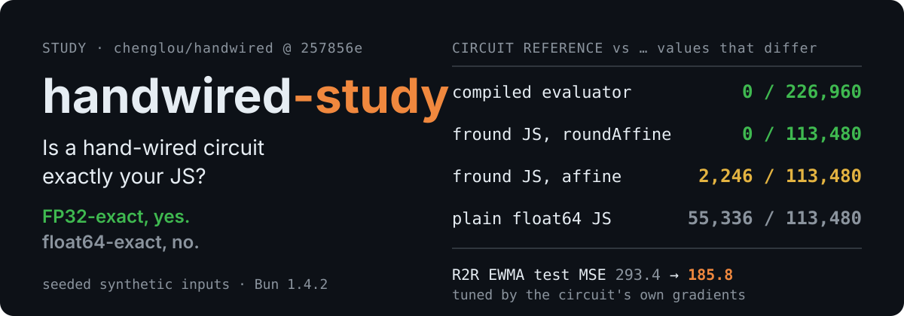

<h1 align="center">handwired-study</h1>

**handwired-study** is a pinned, reproducible look at [chenglou/handwired](https://github.com/chenglou/handwired). It asks two questions: is a hand-wired circuit really "exact" against the JavaScript it replaces, and can its gradients tune the constants of a semiconductor run-to-run controller?

<p align="center">
  
</p>
<p align="center"><em>FP32-exact, yes. float64-exact, no. Every number below is printed by a spike, and claims.json reruns it.</em></p>
<p align="center">
  <a href="https://github.com/alloevil/handwired-study/actions/workflows/claims.yml"></a>
  <a href="https://github.com/chenglou/handwired/commit/257856e3b221140acb4cc4460626b850c0bd4ff1"></a>
  <a href="scripts/setup.sh"></a>
  <a href="LICENSE"></a>
</p>
<p align="center"><a href="#quick-start">Quick start</a> · <a href="plans/plan-A-semiconductor.md">Plan A</a> · <a href="plans/plan-B-exactness.md">Plan B</a> · <a href="claims.json">Claims</a> · <a href="README.zh-CN.md">中文</a></p>

> **Read this first.** handwired does **not** convert existing JavaScript automatically. Its docs say: "No tool converts existing JavaScript source into a program." You rewrite the logic with its builder API (`Circuit.affine` / `roundAffine` / `multiply` / `select`, `emitCompare`, `emitClampExact`, …). Its "exact" means equal to step-by-step FP32 (`Math.fround`), not to float64 JS ([execution model](https://github.com/chenglou/handwired/blob/257856e3b221140acb4cc4460626b850c0bd4ff1/docs/execution-model.md#macro-contracts)).

## "Exact" depends on what you compare against

300 seeded random programs × 40 inputs (30% edge values: −0, subnormals, ties, range ends), each built as a circuit and as plain JS:

| Circuit reference vs … | Values that differ | What it means |
|---|---|---|
| handwired's compiled evaluator | **0 / 226,960** | The two CPU evaluators agree bit for bit |
| JS with `Math.fround` after every step, circuit built with `roundAffine` | **0 / 113,480** | The documented FP32 contract holds |
| the same JS, circuit built with plain `affine` | **2,246 / 113,480** (1.98%) | The builder merges small affine sums, so rounding changes by about 1 ulp |
| plain float64 JS | **55,336 / 113,480** (48.8%) | FP32 vs float64. Median relative error 2.59e-8, p99 1.86e-7, 2 values above 1e-3 |

Gradients: backprop matches central differences of the float64 program in **3,000 / 3,000** cases (worst relative error 2.06e-7). One exception is by design: a threshold that goes through `emitCompare` gets **zero** gradient, which matches [issue #1](https://github.com/chenglou/handwired/issues/1).

## Quick start

Requires git and [Bun](https://bun.sh) (tested with 1.4.2).

```sh
git clone https://github.com/alloevil/handwired-study.git && cd handwired-study
bash scripts/setup.sh          # clones chenglou/handwired into vendor/, pinned at 257856e, then runs bun install
bun spikes/diff-fuzz.ts        # Plan B: the table above, about 1 s
bun spikes/r2r-ewma.ts         # Plan A: R2R EWMA circuit, gradient check, Adam vs baselines, about 1 s
```

All randomness is seeded, so the output should match `spikes/*.out` line for line; only the wall-clock seconds in `r2r-ewma.ts` depend on the machine. To recheck every published number at once with [alloevil/verify-claims](https://github.com/alloevil/verify-claims): `pip install "git+https://github.com/alloevil/verify-claims@v0.1.1"`, then `verify-claims --root . run`.

## Plan A: tune an R2R controller's constants and keep the rule

A run-to-run EWMA controller (CMP polish time, synthetic process) is written as a circuit, with the plant in the loop, so gradients see "λ changed → recipe changed → output changed". Only the two constants move; the rule stays the same.

| On 16 held-out synthetic lots | λ | g | Test MSE |
|---|---|---|---|
| Hand-tuned | 0.3 | 1/9 | 293.39 |
| Coarse grid, 2,050 evaluations | 0.78 | 0.1120 | 202.64 |
| **Circuit gradients (Adam, 300 steps)** | **0.7881** | **0.1110** | **185.81** |

A fine grid (12,120 evaluations) finds the same optimum (train MSE 189.40). With only two constants, a fine grid is enough. The case for gradients is many constants, and that is the next experiment. R2R was chosen over FDC alarms, endpoint detection and piecewise temperature control because those depend on thresholds, and thresholds get zero gradient. → [Full plan (Chinese)](plans/plan-A-semiconductor.md)

## Plan B: verify the "exact" claim like a claims file

The plan turns each part of the README sentence ("exact", "fully differentiable") into a rerunnable claim. It covers differential and fuzz tests against four evaluators, edge values (2^24 + 1, NaN/Infinity inputs, `emitMaximum` drift), gradient vs finite differences, loop unroll limits, and CPU vs WebGPU. → [Full plan with the claims table and blog outline (Chinese)](plans/plan-B-exactness.md)

## What's inside

| Path | What |
|---|---|
| [`plans/`](plans) | Plan A and Plan B, in Chinese: goals, method, steps, effort, success criteria, risks, spike results |
| [`spikes/*.ts`](spikes) | Six spikes: `r2r-ewma`, `r2r-check`, `fdc-threshold`, `diff-fuzz`, `grad-check`, `affine-example` |
| [`spikes/*.out`](spikes) | The recorded output each spike must reproduce |
| [`claims.json`](claims.json) | 12 claims behind the numbers on this page: 11 machine-checked, 1 manual |
| [`scripts/setup.sh`](scripts/setup.sh) | Pins upstream at 257856e. No handwired source is committed here |

## Evidence & limits

- **Synthetic data only.** Every spike uses seeded synthetic inputs, not real tool data. Public datasets named in Plan A (PHM 2016 CMP, SECOM, LAM 9600 etch) appear in the plan only and are not included here.
- **Not tested yet:** CPU vs WebGPU (the study machine has no GPU), loop unroll limits, and the actuator-clamp gradient path (the clamp never fires in the synthetic lots).
- **Upstream baseline:** at 257856e, handwired's own `bun run test` reported 1,347 tests: 1,345 pass, 2 skip, 0 fail. This entry is manual in claims.json because the suite takes about 6 minutes.
- **handwired is young:** a single author, public since 2026-10-14, no npm package, and the author calls it a toy project. Conclusions hold for the pinned commit only.

## License

MIT © alloevil. handwired is MIT-licensed by its author; this repository contains none of its code.
