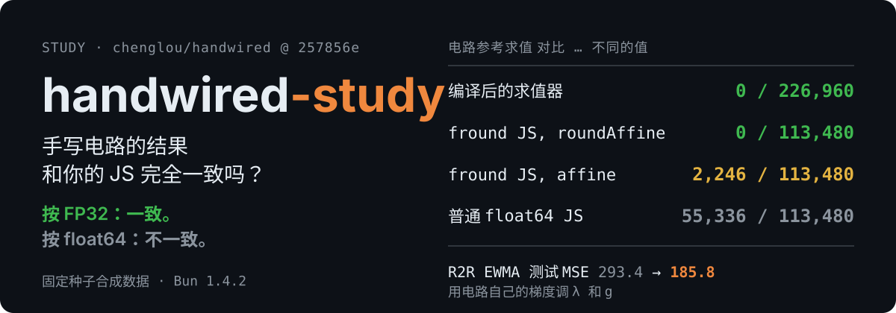

<h1 align="center">handwired-study</h1>

**handwired-study** 是对 [chenglou/handwired](https://github.com/chenglou/handwired) 的调研，固定在一个 commit 上，可以复现。它回答两个问题：手写电路相对于它替代的 JavaScript，到底"精确"到什么程度；电路的梯度能不能拿来调半导体 run-to-run 控制器里的常数。

<p align="center">
  
</p>
<p align="center"><em>按 FP32 是精确的，按 float64 不是。下面每个数字都由 spike 打印出来，claims.json 会重跑核对。</em></p>
<p align="center">
  <a href="https://github.com/alloevil/handwired-study/actions/workflows/claims.yml"></a>
  <a href="https://github.com/chenglou/handwired/commit/257856e3b221140acb4cc4460626b850c0bd4ff1"></a>
  <a href="scripts/setup.sh"></a>
  <a href="LICENSE"></a>
</p>
<p align="center"><a href="#快速开始">快速开始</a> · <a href="plans/plan-A-semiconductor.md">方案 A</a> · <a href="plans/plan-B-exactness.md">方案 B</a> · <a href="claims.json">Claims</a> · <a href="README.md">English</a></p>

> **先说清楚**：handwired **不会自动转换现成的 JavaScript**。官方文档原话："No tool converts existing JavaScript source into a program." 你需要用它的 builder API（`Circuit.affine` / `roundAffine` / `multiply` / `select`、`emitCompare`、`emitClampExact` 等）把逻辑手写一遍。它说的"exact"指的是等于逐步 FP32（`Math.fround`）计算，不等于 float64 的 JS（[execution model](https://github.com/chenglou/handwired/blob/257856e3b221140acb4cc4460626b850c0bd4ff1/docs/execution-model.md#macro-contracts)）。

## "精确"要看跟谁比

300 个固定种子的随机程序，每个程序 40 组输入（其中 30% 是边界值：−0、次正规数、相等值、区间端点），每个程序同时写成电路和普通 JS：

| 电路参考求值 对比 … | 不同的值 | 含义 |
|---|---|---|
| handwired 编译后的求值器 | **0 / 226,960** | 两个 CPU 求值器逐位一致 |
| 每步都 `Math.fround` 的 JS（电路用 `roundAffine` 写） | **0 / 113,480** | 文档承诺的 FP32 合约成立 |
| 同样的 JS（电路用普通 `affine` 写） | **2,246 / 113,480**（1.98%） | builder 会合并小的 affine 运算，舍入点变了，结果差 1 ulp 左右 |
| 普通 float64 JS | **55,336 / 113,480**（48.8%） | FP32 和 float64 的差别；相对误差中位数 2.59e-8，p99 1.86e-7，有 2 个值超过 1e-3 |

梯度：反传梯度和 float64 程序的中心差分对比，**3,000 / 3,000** 组一致，最大相对误差 2.06e-7。有一个是设计如此的例外：经过 `emitCompare` 的阈值梯度是 **0**，和 [issue #1](https://github.com/chenglou/handwired/issues/1) 说的一致。

## 快速开始

需要 git 和 [Bun](https://bun.sh)（测试版本 1.4.2）。

```sh
git clone https://github.com/alloevil/handwired-study.git && cd handwired-study
bash scripts/setup.sh          # 把 chenglou/handwired 克隆到 vendor/，固定在 257856e，再执行 bun install
bun spikes/diff-fuzz.ts        # 方案 B：上面那张表，约 1 秒
bun spikes/r2r-ewma.ts         # 方案 A：R2R EWMA 电路、梯度检查、Adam 和基线对比，约 1 秒
```

所有随机数都有固定种子，输出应该和 `spikes/*.out` 逐行一致；只有 `r2r-ewma.ts` 里的耗时秒数会随机器变化。一次性核对所有公开数字，用 [alloevil/verify-claims](https://github.com/alloevil/verify-claims)：先 `pip install "git+https://github.com/alloevil/verify-claims@v0.1.1"`，再 `verify-claims --root . run`。

## 方案 A：调 R2R 控制器的常数，规则本身不动

把 run-to-run EWMA 控制器（CMP 抛光时间，工艺是合成的）写成电路，把工艺模型也放进闭环，这样梯度能看到"λ 变了 → 配方变了 → 输出变了"这整条链。只调两个常数，规则结构不变。

| 16 个留出的合成 lot 上 | λ | g | 测试 MSE |
|---|---|---|---|
| 手调 | 0.3 | 1/9 | 293.39 |
| 粗网格，2,050 次评估 | 0.78 | 0.1120 | 202.64 |
| **电路梯度（Adam，300 步）** | **0.7881** | **0.1110** | **185.81** |

细网格（12,120 次评估）找到的是同一个最优点（训练 MSE 189.40）。只有两个常数时，细网格就够用了；梯度法的优势要等常数多起来才显现，这是下一步要做的实验。选 R2R 而没选 FDC 报警、端点检测或分段温控，是因为后面这几个都靠阈值，而阈值拿不到梯度。→ [完整方案](plans/plan-A-semiconductor.md)

## 方案 B：用 claims 的方式验证"精确"这个说法

README 那句话里的"exact"和"fully differentiable"，都拆成可以重跑的 claim：四路差分和模糊测试，边界值（2^24 + 1、NaN/Infinity 输入、`emitMaximum` 的偏差），梯度和数值差分对比，循环展开上限，以及 CPU 和 WebGPU 的一致性。→ [完整方案，含 claims 表和博客结构](plans/plan-B-exactness.md)

## 仓库内容

| 路径 | 内容 |
|---|---|
| [`plans/`](plans) | 方案 A 和方案 B：目标、方法、步骤、工作量、成功标准、风险、spike 结果 |
| [`spikes/*.ts`](spikes) | 6 个 spike：`r2r-ewma`、`r2r-check`、`fdc-threshold`、`diff-fuzz`、`grad-check`、`affine-example` |
| [`spikes/*.out`](spikes) | 记录下来的输出，每个 spike 都必须能复现 |
| [`claims.json`](claims.json) | 本页数字背后的 12 条 claim：11 条机器核对，1 条人工 |
| [`scripts/setup.sh`](scripts/setup.sh) | 把上游固定在 257856e；本仓库不提交 handwired 的源码 |

## 证据与局限

- **全部是合成数据**：所有 spike 都用固定种子生成的合成输入，不是真实设备数据。方案 A 提到的公开数据集（PHM 2016 CMP、SECOM、LAM 9600 etch）只出现在计划里，本仓库没有收录。
- **还没测的**：CPU 和 WebGPU 的一致性（调研用的机器没有 GPU）、循环展开上限、执行器限幅那段的梯度（合成数据里限幅从没触发）。
- **上游基线**：在 257856e 上，handwired 自带的 `bun run test` 跑了 1,347 个测试，1,345 通过、2 跳过、0 失败。这一项跑一次要 6 分钟左右，所以在 claims.json 里标为人工核对。
- **handwired 还很早期**：单作者，2026-10-14 才公开，没有 npm 包，作者自己说是玩具项目。所有结论只对固定的这个 commit 成立。

## 许可

MIT © alloevil。handwired 由原作者以 MIT 许可发布，本仓库不包含它的任何代码。
